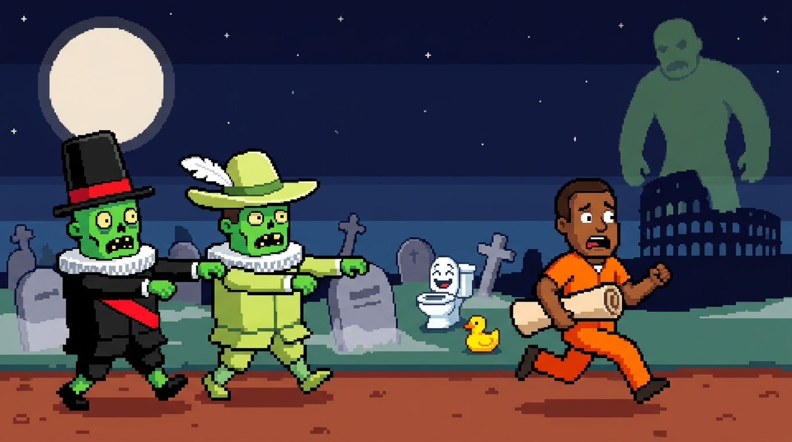
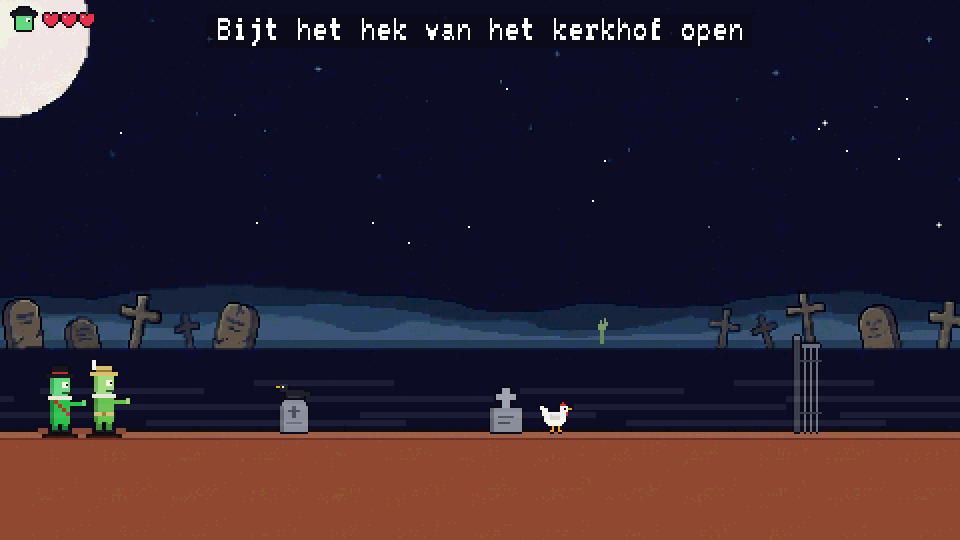
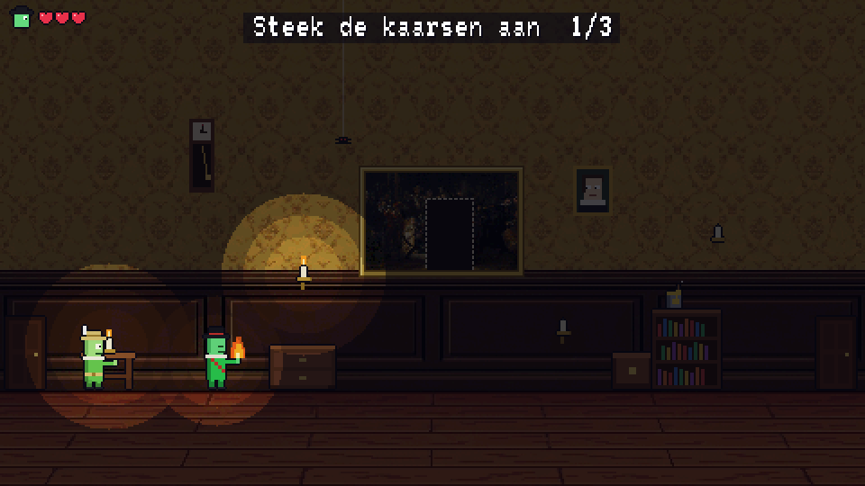
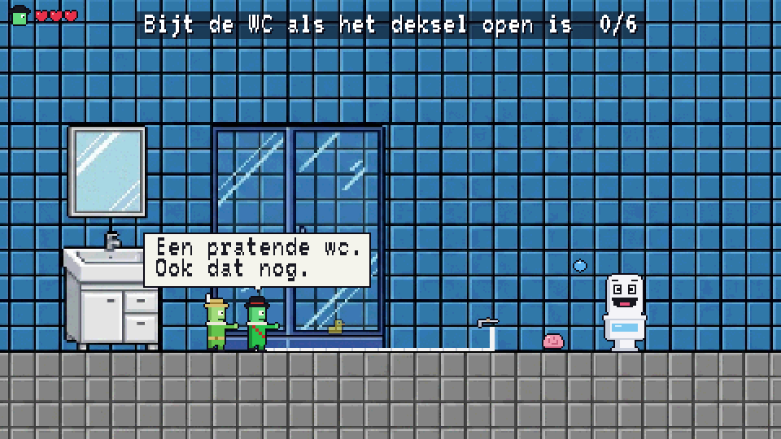
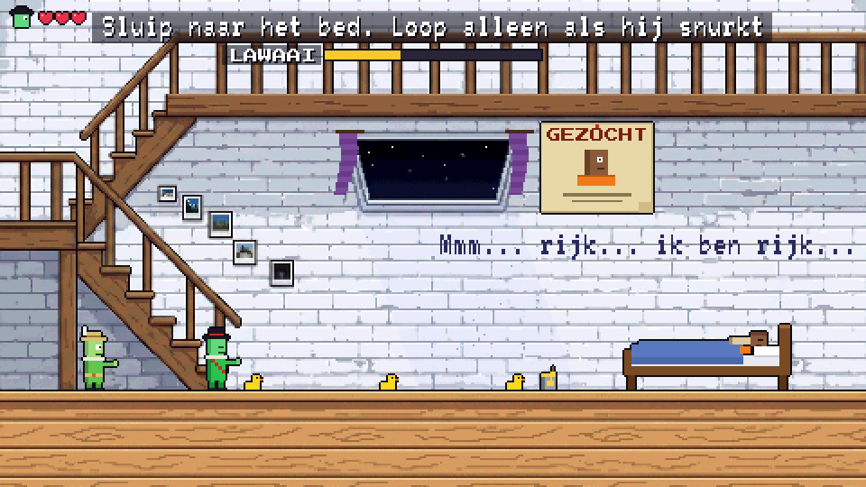
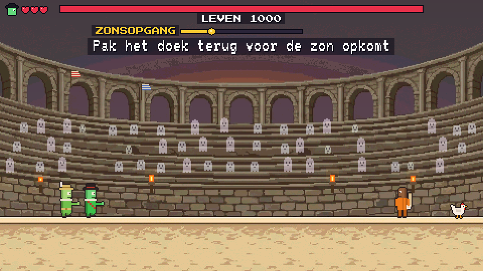
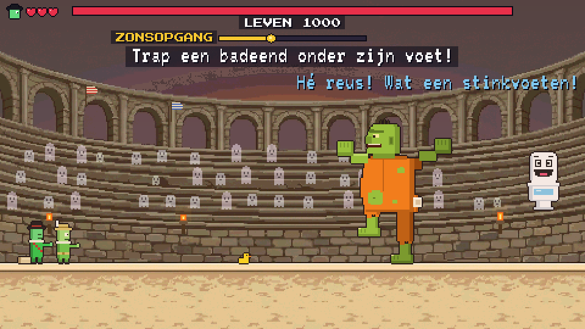
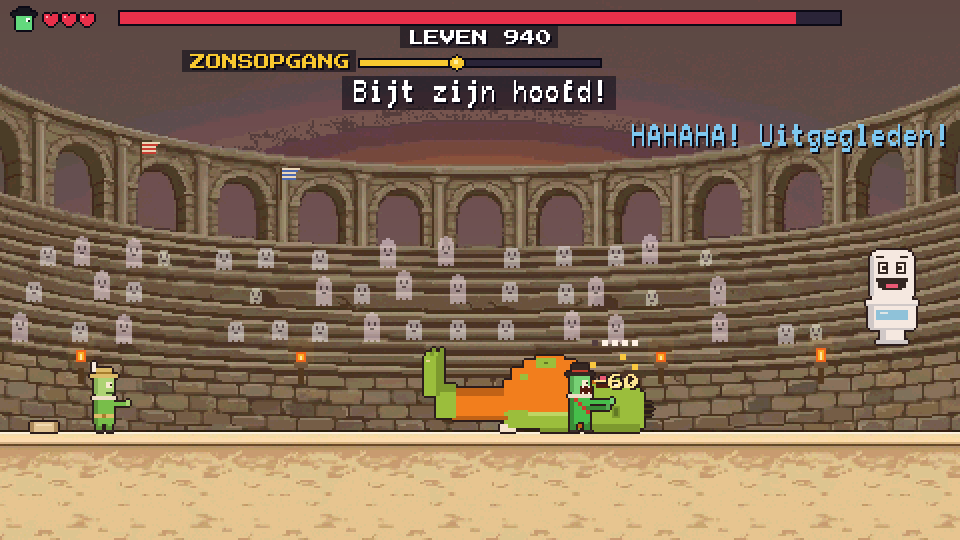
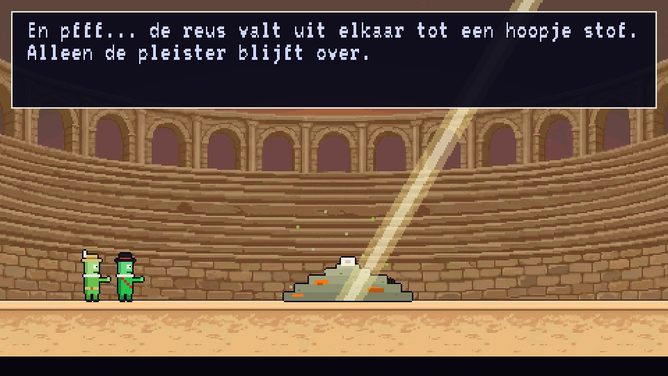

<p align="center">
  
</p>

<h1 align="center">De Donkere Nacht Remake</h1>

<p align="center">
  <b>Get the painting back before sunrise!</b><br>
  A pixel-art zombie adventure for 1 or 2 players, in the browser and on Windows.
</p>

<p align="center">
  <a href="https://aikkuypers2005.github.io/De-Donkere-Nacht-Remake/"><b>Play in the browser</b></a>
  &nbsp;·&nbsp;
  <a href="https://github.com/aikkuypers2005/De-Donkere-Nacht-Remake/releases/latest"><b>Download for Windows</b></a>
</p>

A pixel-art remake of [*De Donkere Nacht*](https://github.com/aikkuypers2005/De-Donkere-Nacht), based on the original `de_donkere_nacht_door_job_en_aik.pde` sketch that Aik & Job made at De Jonge Onderzoekers Groningen in 2016.

On the darkest night of the year a thief in an orange suit cuts a piece out of Rembrandt's *De Nachtwacht*. The theft wakes two guards from the painting, dead for almost 400 years. As zombies, they follow his trail through a graveyard, a forest and his own house, chase him into an old arena, and have to get the canvas back before the sun comes up. The game is in Dutch and English.

## Screenshots

| | |
|:---:|:---:|
| <br>Chapter 1: rising from the graveyard | <br>Chapter 2: lighting the candles in the hallway |
| <br>Chapter 3: the Laughing Toilet | <br>Chapter 4: sneak to the bed while he snores |
| <br>Chapter 5: the thief in the arena | <br>The giant, with the ghost crowd watching |
| <br>Kick a duck under his foot, then bite his head | <br>The ending: dust, a plaster and the sunrise |

The screenshots are from the Windows version; the browser version looks the same. The cover picture is an illustration, not a screenshot.

## How the game works

- **Chapters.** Every chapter starts with a cutscene and has one goal:

  | Chapter | Goal |
  |---|---|
  | 1. Het Ontwaken | Bite the graveyard gate open, then find the orange threads in the forest |
  | 2. Het Huis | Get the key from the crow, then light the candles in the dark hallway |
  | 3. De Lachende WC | Bite the toilet while its lid is open |
  | 4. HELP ZOMBIES | Sneak to the bed while he snores, then keep up in the chase |
  | 5. De Arena | Win the canvas back from the thief before sunrise |

- **The giant.** On the way out of the bedroom a zombie bites the thief in the behind. In the arena the bite kicks in and he grows into a giant, four times your size, with a new `leven = 1000` bar. He cannot be hurt standing up. The Laughing Toilet throws rubber ducks from the stands: kick one under his feet, he slips onto his back, and you can bite his head. Losing restarts the giant fight, not the arena.
- **Power-ups.** Every scene hides one, somewhere that takes a little effort:

  | Power-up | Effect |
  |---|---|
  | Hersens (brains) | One heart back |
  | Gouden verf (gold paint) | 8 seconds of no damage, and you walk faster |
  | De kip (the chicken, from the girl's belt in *De Nachtwacht*) | 10 seconds of biting twice as far; bosses take double damage |

  Power-ups carry on into the next scene. Their timers stop during cutscenes.
- **Hearts.** Each zombie has three. With two players, a fallen zombie gets back up after a few seconds while the other is still standing. If everyone is down, the scene restarts.
- **Sunrise.** The arena and the giant fight run on a sunrise timer. If the sun comes up first, the zombies turn to dust and you try again.

## Play in the browser

Play online: https://aikkuypers2005.github.io/De-Donkere-Nacht-Remake/

Or run it on your own computer:

```powershell
node serve.js
```

Then open http://localhost:8123. Opening `index.html` directly from disk does not work, because browsers block the images that way.

- **Play alone:** every device controls your zombie; the second zombie follows you.
- **Together on 1 computer:** each player picks a device under *Controls*.
- **Online:** one player hosts and gives the 4-letter code to the other.

| Device | Walk | Jump | Bite / use | Pause |
|---|---|---|---|---|
| Keys 1 | A, D | W or Space | F | Esc |
| Keys 2 | Left, Right | Up | Enter | Esc |
| Mouse (as in 2016) | Left / right button | Wheel up | Middle button | |
| Controller | Stick or D-pad | Cross (A) | Square (X) | Options |

`Shift+X` and `Shift+B`, the cheats from the 2016 game, skip a scene forward or back.

## Windows version

`processing/DeDonkereNacht` is the same game for Processing 4 (Java mode): play alone or with 2 players on one computer, with keyboard, mouse or controller. It has no online play. Download the installer `DeDonkereNachtRemake-Setup-1.0.0.exe` from the [Releases page](https://github.com/aikkuypers2005/De-Donkere-Nacht-Remake/releases), or open `DeDonkereNacht.pde` in Processing and press Run. The installer puts the game in the Start menu and on the desktop and needs no admin rights. It is not code-signed, so Windows SmartScreen may warn; choose "More info" and then "Run anyway". See `installer/README.md` for how to rebuild it.

## Sound and music

Both versions have sound effects and background music. "Music: on / off" is in the title menu.

The sound effects are not recordings: each one is built in code from a few tones and noise, the same way in both versions.

Music: *Night of Chaos*, the track that shipped with the original 2016 game. The Windows version uses a smaller mono copy.

In a browser the sound starts after your first key press or click (browsers do not allow it earlier).

## Tests

```powershell
node test/smoke.js     # the rules: every scene, the giant, power-ups, a full game from start to end
```

The Windows version runs the same checks:

```powershell
& "C:\Program Files\Processing\Processing.exe" cli --sketch="processing\DeDonkereNacht" --output="..\ddn-pde-build" --force --run test
```

Add `shots <folder>` instead of `test` to save a picture of every scene.

These links open one part of the browser version directly:

- `?scene=giant&nocut=1` starts the giant fight (`&p=2` for two players).
- `?scene=arena&cut=turn&i=3` shows one cutscene line.
- `?hp=60` sets the boss's leven, `?sun=0.9` the sunrise, `?stun=1` puts the giant on his back.
- `?gold=1` and `?chick=1` give player 1 that power-up, `?talk=z_key` shows a speech bubble, `?idle=1` starts the head-drops-off gag.
- `?end=1` shows the end screen.

## Changing the game

| File | What it holds |
|---|---|
| `src/sim.js` | The game rules: scenes, enemies, bosses, power-ups, timings |
| `src/text.js` | All Dutch and English text, and the cutscene scripts |
| `src/draw.js` | Pixel sprites, backgrounds, HUD, cutscenes |
| `src/fx.js` | Dust, sparks, damage numbers and the little things that move in each scene |
| `src/input.js` | Keyboard, mouse, controller |
| `src/audio.js` | Music and sound effects |
| `src/net.js` | Online co-op (PeerJS) |
| `src/main.js` | The p5.js sketch: loop and menus |

Rule and text changes must be repeated in `processing/DeDonkereNacht/Sim.pde` and `Text.pde`.

## Credits

- Original game and idea: Job & Aik, 2016.
- *De Nachtwacht*: Rembrandt van Rijn, 1642 (public domain).
- Backgrounds and cover: AI-generated pixel art. Characters and objects are drawn in code.
- Libraries: p5.js (LGPL), PeerJS (MIT). Fonts: Press Start 2P and VT323 (SIL Open Font License).
- Windows version: controller support through [Jamepad](https://github.com/williamahartman/Jamepad), which bundles SDL2 (zlib License).
- License: [MIT](LICENSE)
